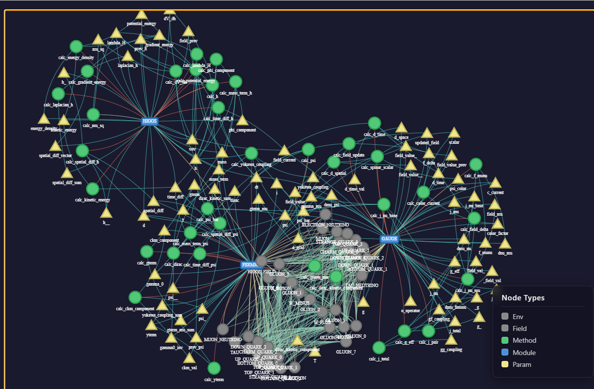

# EQUADOR 
Creates a StandardModel (SM) KB. 

Ill implement some features to make SM optional so you can test it with your own Equations.

Primary Outputs:

runtime.json - entire config ready to calculate on the Grid (no optimized currently)

visual.html - relatonal mapping of fields and parameters good for learning etc

graph.json - the blank Graph as a KB

Requirements (clone into firegraph)
https://github.com/wired87/utils
https://github.com/wired87/qfu 
https://github.com/wired87/file

pip install -r r.txt

ToDo:
Merge into firegraph

Required later then (DO NOT PROVIDE THIS ATTENTION RIGHT NOW!):
module/model/env interaction mapping 
field interaction mapping
fields and its params mapping

